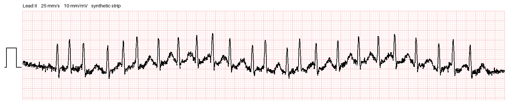
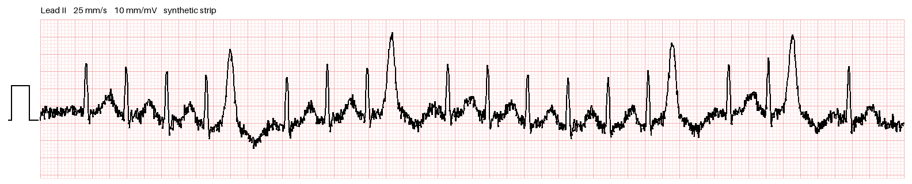
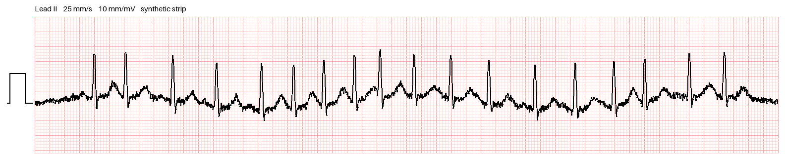
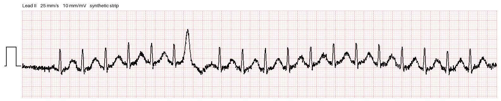
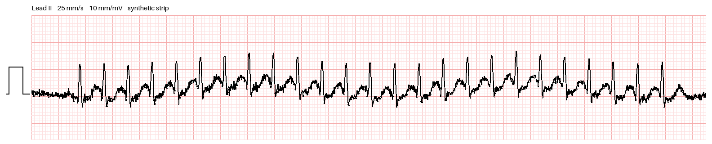
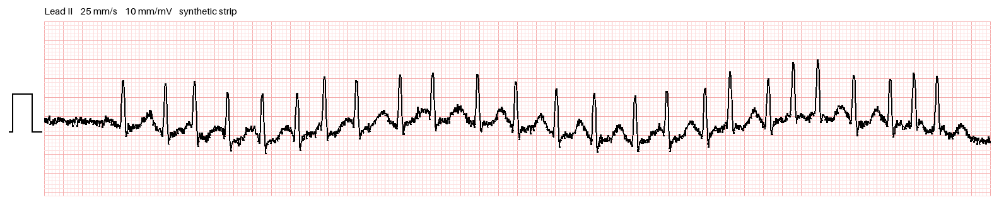
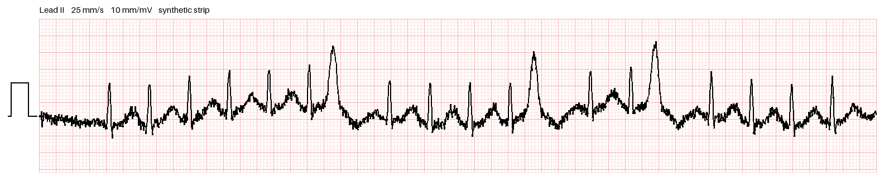
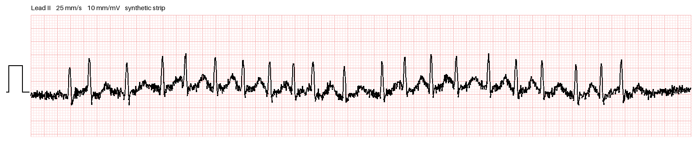
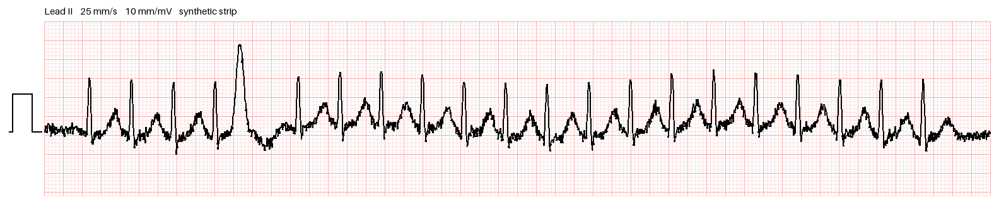
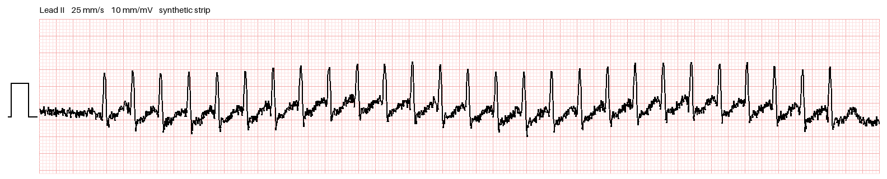

# Review sheet

These are synthetic measuring-and-counting tasks made from a seeded generator. They are not clinical cases and nothing here is a diagnosis or medical advice.

Open `tasks/review.html` in a browser to try each task before revealing the answer. Check a task by hand with `python3 -m validate.hand_check TASK_ID --by "Your Name"`.

## ecg_beat_count_000

**Question:** This is a 10-second ECG rhythm strip (standard grid: 25 mm/s). How many QRS complexes (heartbeats) are on the strip? Give a whole number.

**Correct answer:** 24 (exact)

**How to check it by hand:**
- Count every tall, narrow QRS spike (the sharp peak of each heartbeat). Ignore the small rounded bumps (P and T waves) and the noise.
- Mark each peak with a pencil on a printout, or count in blocks of 5 large boxes (1 second = 5 large boxes).

Data it was drawn from: `tasks/data/ecg_beat_count_000.json` (seed 183193602768262).

| model | answered | marked |
|---|---|---|
| Claude Haiku 5.5 | 24 | correct |
| GPT-6 Luna | 24 | correct |

## ecg_ectopic_count_000

**Question:** Count the beats on this strip that come earlier than expected and look different from the rest (wider, taller, no preceding small bump). How many are there? Give a whole number.

**Correct answer:** 4 (exact)

**How to check it by hand:**
- Find every beat that is wider and taller than the normal beats, arrives early and has no small bump before it.
- Count them. Two of them are never next to each other, and the normal beats between them are narrow and sharp.

Data it was drawn from: `tasks/data/ecg_ectopic_count_000.json` (seed 217855308976099).

| model | answered | marked |
|---|---|---|
| Claude Haiku 5.5 | 4 | correct |
| GPT-6 Luna | 4 | correct |

## ecg_interval_000

**Question:** Measure on the grid (large box = 5 mm = 0.2 s) the distance from the tall peak of beat 2 to the tall peak of beat 10 (beats counted from the left, first beat = 1). How many large boxes is it? Answers within +/-0.5 of the correct value are accepted.

**Correct answer:** 19.4 (accepted: within +/-0.5)

**How to check it by hand:**
- Count beats from the left (first peak = 1) to find the two named beats.
- Count the large boxes (darker 5 mm squares, 0.2 s each) from the tip of the first peak to the tip of the second; count a small box as 0.2 of a large box.

Data it was drawn from: `tasks/data/ecg_interval_000.json` (seed 145209111897439).

| model | answered | marked |
|---|---|---|
| Claude Haiku 5.5 | 19.4 | correct |
| GPT-6 Luna | 11.6 | wrong |

## ecg_premature_beat_000

**Question:** One beat on this 10-second ECG rhythm strip arrives early and looks wider and taller than the others. Counting the QRS complexes from the left and starting at 1, which beat is it? Give a whole number.

**Correct answer:** 7 (exact)

**How to check it by hand:**
- Find the one beat that is wider and taller than the rest, arrives early (a shorter gap before it) and has no small bump before it.
- Count the tall peaks from the left, first peak = 1, and report the position of that early beat.

Data it was drawn from: `tasks/data/ecg_premature_beat_000.json` (seed 250473614012519).

| model | answered | marked |
|---|---|---|
| Claude Haiku 5.5 | 7 | correct |
| GPT-6 Luna | 7 | correct |

## ecg_rate_000

**Question:** This is a steady 10-second ECG rhythm strip (standard grid: 25 mm/s, large box = 0.2 s). Using the spacing between consecutive beats (not by counting the beats in the strip and multiplying), what is the heart rate in beats per minute? Answers within +/-3 of the correct value are accepted.

**Correct answer:** 167 (accepted: within +/-3)

**How to check it by hand:**
- Find the spacing between two consecutive tall peaks in large boxes (the darker 5 mm squares). 1 large box = 0.2 s.
- Rate in beats per minute = 300 / (large boxes between peaks). Check a few neighbouring pairs; the strip is steady.

Data it was drawn from: `tasks/data/ecg_rate_000.json` (seed 186563790547137).

| model | answered | marked |
|---|---|---|
| Claude Haiku 5.5 | 167 | correct |
| GPT-6 Luna | 167 bpm | correct |

## ecg_beat_count_001

**Question:** This is a 10-second ECG rhythm strip (standard grid: 25 mm/s). How many QRS complexes (heartbeats) are on the strip? Give a whole number.

**Correct answer:** 25 (exact)

**How to check it by hand:**
- Count every tall, narrow QRS spike (the sharp peak of each heartbeat). Ignore the small rounded bumps (P and T waves) and the noise.
- Mark each peak with a pencil on a printout, or count in blocks of 5 large boxes (1 second = 5 large boxes).

Data it was drawn from: `tasks/data/ecg_beat_count_001.json` (seed 77445202232809).

| model | answered | marked |
|---|---|---|
| Claude Haiku 5.5 | 25 | correct |
| GPT-6 Luna | 25 | correct |

## ecg_ectopic_count_001

**Question:** Count the beats on this strip that come earlier than expected and look different from the rest (wider, taller, no preceding small bump). How many are there? Give a whole number.

**Correct answer:** 3 (exact)

**How to check it by hand:**
- Find every beat that is wider and taller than the normal beats, arrives early and has no small bump before it.
- Count them. Two of them are never next to each other, and the normal beats between them are narrow and sharp.

Data it was drawn from: `tasks/data/ecg_ectopic_count_001.json` (seed 163845755467807).

| model | answered | marked |
|---|---|---|
| Claude Haiku 5.5 | 3 | correct |
| GPT-6 Luna | 3 | correct |

## ecg_interval_001

**Question:** Measure on the grid (large box = 5 mm = 0.2 s) the distance from the tall peak of beat 7 to the tall peak of beat 13 (beats counted from the left, first beat = 1). How many large boxes is it? Answers within +/-0.5 of the correct value are accepted.

**Correct answer:** 12.26 (accepted: within +/-0.5)

**How to check it by hand:**
- Count beats from the left (first peak = 1) to find the two named beats.
- Count the large boxes (darker 5 mm squares, 0.2 s each) from the tip of the first peak to the tip of the second; count a small box as 0.2 of a large box.

Data it was drawn from: `tasks/data/ecg_interval_001.json` (seed 231026789173078).

| model | answered | marked |
|---|---|---|
| Claude Haiku 5.5 | 12.2 | correct |
| GPT-6 Luna | 12.3 | correct |

## ecg_premature_beat_001

**Question:** One beat on this 10-second ECG rhythm strip arrives early and looks wider and taller than the others. Counting the QRS complexes from the left and starting at 1, which beat is it? Give a whole number.

**Correct answer:** 5 (exact)

**How to check it by hand:**
- Find the one beat that is wider and taller than the rest, arrives early (a shorter gap before it) and has no small bump before it.
- Count the tall peaks from the left, first peak = 1, and report the position of that early beat.

Data it was drawn from: `tasks/data/ecg_premature_beat_001.json` (seed 124924982250635).

| model | answered | marked |
|---|---|---|
| Claude Haiku 5.5 | 5 | correct |
| GPT-6 Luna | 5 | correct |

## ecg_rate_001

**Question:** This is a steady 10-second ECG rhythm strip (standard grid: 25 mm/s, large box = 0.2 s). Using the spacing between consecutive beats (not by counting the beats in the strip and multiplying), what is the heart rate in beats per minute? Answers within +/-3 of the correct value are accepted.

**Correct answer:** 181 (accepted: within +/-3)

**How to check it by hand:**
- Find the spacing between two consecutive tall peaks in large boxes (the darker 5 mm squares). 1 large box = 0.2 s.
- Rate in beats per minute = 300 / (large boxes between peaks). Check a few neighbouring pairs; the strip is steady.

Data it was drawn from: `tasks/data/ecg_rate_001.json` (seed 279154476071028).

| model | answered | marked |
|---|---|---|
| Claude Haiku 5.5 | 180 | correct |
| GPT-6 Luna | 180 bpm | correct |

